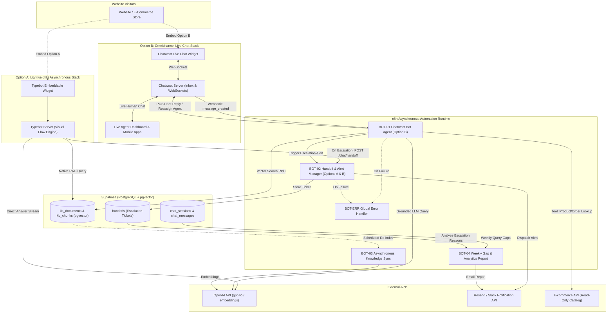
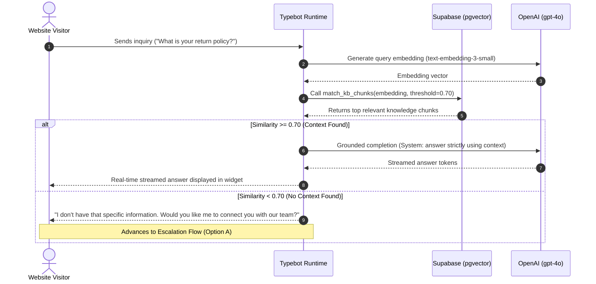
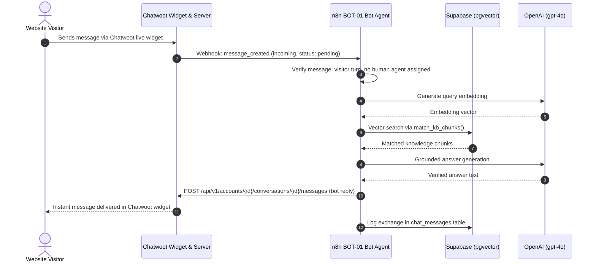
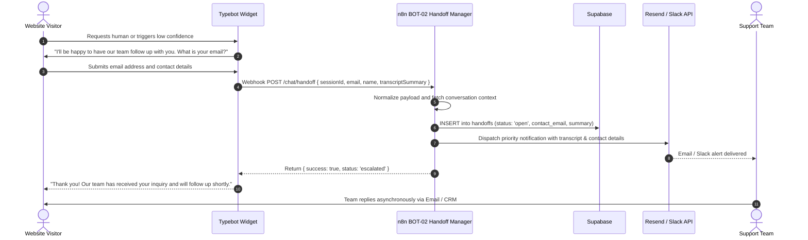
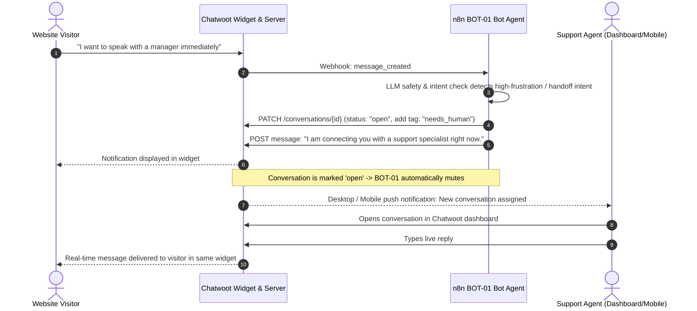

# Automation Architecture — Website AI Chatbot System

**Document Version:** 2.0.0  
**Status:** Approved Architecture  
**Author:** Principal Systems and Automation Architect  

---

## Executive Summary

The **Website AI Chatbot System** provides intelligent, grounded customer assistance for websites and e-commerce platforms while offering a seamless bridge to human team members.

### Architectural Refactoring & Problem Statement
Previous iterations suffered from three core architectural anti-patterns:
1. **Synchronous Streaming Bottlenecks in n8n**: Routing visitor-facing real-time chat tokens through synchronous n8n workflows held worker execution queues open for 15–30 seconds per turn. Under moderate traffic spikes, this choked n8n's concurrency, exhausting database connection pools and stalling mission-critical background jobs.
2. **Custom Frontend Maintenance Debt**: Maintaining a custom vanilla JavaScript widget (`widget/` directory), session storage layer, responsive styling, and cross-browser WebSocket logic introduced unnecessary development and security overhead.
3. **Custom Edge Gateway Overhead**: Hand-rolled gateway proxies for rate-limiting and token signing added fragility without matching the capabilities of established conversational platforms.

### The Refactored Solution
This architecture decouples the **synchronous visitor conversational loop** from the **asynchronous automation and intelligence layer**:
- **Visitor Layer (Decoupled Frontends)**: Built on proven, open-source conversational software with zero custom widget maintenance. The system provides two distinct implementation paths:
  - **Option A (Lightweight / Asynchronous)**: **Typebot + n8n + Supabase**
  - **Option B (Omnichannel / Live Agent Takeover)**: **Chatwoot + n8n + Supabase**
- **Data & Intelligence Layer**: **Supabase (PostgreSQL + pgvector)** serves as the single source of truth for semantic knowledge vectors, interaction logs, and escalation records.
- **Asynchronous Automation Layer (n8n)**: Dedicated exclusively to event-driven webhooks, agent handoff routing, scheduled knowledge base re-indexing (`BOT-03`), and weekly gap analytics reporting (`BOT-04`).

---

## 1. Architectural Principles

1. **Strictly Grounded Knowledge Retrieval**: The bot answers strictly from indexed company knowledge (FAQ, documentation, policies, catalog data) with similarity thresholding (cosine similarity $\ge 0.70$). If relevant context is absent, the system deterministically refuses to guess and triggers human escalation.
2. **Decoupled Real-Time & Background Loops**: n8n is entirely removed from the real-time token streaming path. Streaming and presence are handled natively by Typebot or Chatwoot; n8n functions strictly as an asynchronous webhook worker.
3. **Zero Custom Frontend Code**: Uses battle-tested, accessible, and responsive open-source widgets (Typebot web component or Chatwoot live widget).
4. **First-Class Human Intervention**: Escalation is designed as an expected, seamless operational path:
   - In **Option A**, visitor contact information is captured and routed asynchronously to email/Slack tickets.
   - In **Option B**, conversations are reassigned to human agents in real time inside the same widget, instantly muting the bot.
5. **Read-Only Scoped Tool Execution**: E-commerce catalog lookups and order status checks are strictly read-only and require double verification (e.g. Order Number + Email). The bot cannot modify records, issue refunds, or apply custom discounts.
6. **Defense-in-Depth & Privacy**: Untrusted visitor inputs are delimited to prevent prompt injection. Personally identifiable information (PII) is restricted to escalation tickets, with configurable retention limits.

---

## 2. High-Level System Architecture



---

## 3. Core Data Flows & Sequence Diagrams

### 3.1. Standard Grounded RAG Query

#### Path 1: Option A (Typebot Native Loop)


#### Path 2: Option B (Chatwoot + BOT-01 Webhook Loop)


---

### 3.2. Escalation Flow — Option A (Typebot Asynchronous Capture)
Designed for teams without dedicated live chat agents. When escalation triggers, Typebot collects the visitor's contact info and hands off asynchronously to n8n.



---

### 3.3. Escalation Flow — Option B (Chatwoot Live Agent Takeover)
Designed for organizations with customer support agents available for real-time live chat takeover.



---

## 4. Comparison & Selection Matrix: Option A vs. Option B

| Architectural Dimension | Option A: Typebot + n8n + Supabase | Option B: Chatwoot + n8n + Supabase |
| :--- | :--- | :--- |
| **Primary Target Use Case** | Lead qualification, inbound marketing, FAQ bots, asynchronous support ticket intake. | Real-time customer support, e-commerce concierge, dedicated helpdesk teams. |
| **Escalation Mechanism** | **Asynchronous**: Captures visitor email/phone; dispatches ticket via n8n to Slack/Email. | **Synchronous / Real-Time**: Live agent takes over conversation in the same widget; mobile app notifications. |
| **Real-Time Streaming** | Native Typebot streaming directly to browser (zero n8n queue congestion). | Native Chatwoot WebSocket streaming and typing indicators. |
| **Hosting Footprint** | **Very Low**: ~1 GB RAM. Single lightweight Docker container (or hosted Typebot cloud). | **Medium**: ~2–4 GB RAM. Requires Redis, PostgreSQL, and Chatwoot web/worker containers. |
| **Build & Setup Complexity** | **Low**: Visual drag-and-drop builder; quick web component embed; fast time-to-market (< 2 days). | **Moderate**: Requires configuring Chatwoot inboxes, webhooks, agent accounts, and bot tokens. |
| **Omnichannel Support** | Web embed only (Iframe, Standard web component, bubble). | **Comprehensive Omnichannel**: Web widget, WhatsApp, Instagram DM, Facebook Messenger, Email. |
| **Agent Experience** | No agent live chat UI; team handles tickets in existing email inbox or Slack. | Comprehensive agent portal, mobile apps (iOS/Android), collision detection, canned responses. |
| **Recommended For** | Solo founders, early-stage SaaS, lean teams without 24/7 staff coverage. | Customer support teams, e-commerce stores with active operators, multi-channel businesses. |

---

## 5. Workflow & Service Catalog

### 5.1. Responsibility Breakdown (Widget Layer vs. Automation Layer)

```
┌────────────────────────────────────────────────────────────────────────────┐
│ CONVERSATIONAL FRONTEND LAYER                                              │
│                                                                            │
│ OPTION A: Typebot Runtime                                                  │
│ - Embeddable widget injection & visual theme rendering                    │
│ - Interactive form validation (email, phone, single-select buttons)        │
│ - Direct OpenAI streaming & Supabase pgvector semantic search              │
│ - Asynchronous handoff trigger on low confidence or visitor request        │
│                                                                            │
│ OPTION B: Chatwoot Platform                                                │
│ - Embeddable live chat widget with WebSocket presence and typing state     │
│ - Omnichannel message aggregation (Web, WhatsApp, Meta)                    │
│ - Agent assignment, team queues, canned responses, and conversation state  │
│ - Mobile apps (iOS & Android) with push notifications for live agents      │
└─────────────────────────────────────┬──────────────────────────────────────┘
                                      │ Event Webhooks
                                      ▼
┌────────────────────────────────────────────────────────────────────────────┐
│ ASYNCHRONOUS AUTOMATION RUNTIME (n8n)                                      │
│                                                                            │
│ BOT-01: Chatwoot Bot Agent                                                 │
│ - Ingests message_created events from Chatwoot                             │
│ - Enforces bot muting when live human agents are assigned                  │
│ - Executes grounded pgvector search & LLM generation                       │
│ - Posts bot replies or escalates conversation via Chatwoot API             │
│                                                                            │
│ BOT-02: Universal Handoff & Alert Manager                                  │
│ - Ingests escalation payloads from Typebot (Option A) or Chatwoot (Option B)│
│ - Generates 2-sentence context summary of session turns                    │
│ - Logs ticket in Supabase handoffs table                                   │
│ - Delivers structured alerts to team via Resend / Slack                    │
│                                                                            │
│ BOT-03: Asynchronous Knowledge Base Sync                                   │
│ - Scheduled / on-demand re-indexing of CMS, documentation, and policies    │
│ - Document chunking and embedding generation (text-embedding-3-small)      │
│ - Upserts into Supabase kb_chunks with deduplication                       │
│                                                                            │
│ BOT-04: Analytics & Unanswered Gap Reporter                                │
│ - Weekly scheduled analysis of unresolved queries & handoff tickets        │
│ - LLM clustering of customer questions into actionable FAQ suggestions     │
│ - Delivers executive weekly digest to product and support owners           │
│                                                                            │
│ BOT-ERR: Global Workflow Error Handler                                     │
│ - Catches uncaught runtime exceptions across all n8n workflows             │
│ - Logs incident to workflow_log table and alerts administrator             │
└────────────────────────────────────────────────────────────────────────────┘
```

---

## 6. Database Architecture & Schema (Supabase)

```sql
-- 1. Enable pgvector
CREATE EXTENSION IF NOT EXISTS vector;

-- 2. Knowledge documents and vector chunks
CREATE TABLE IF NOT EXISTS kb_documents (
  id UUID PRIMARY KEY DEFAULT gen_random_uuid(),
  title TEXT NOT NULL,
  source_type TEXT NOT NULL CHECK (source_type IN ('faq', 'policy', 'page', 'product')),
  source_url TEXT,
  updated_at TIMESTAMPTZ DEFAULT now()
);

CREATE TABLE IF NOT EXISTS kb_chunks (
  id UUID PRIMARY KEY DEFAULT gen_random_uuid(),
  document_id UUID REFERENCES kb_documents(id) ON DELETE CASCADE,
  content TEXT NOT NULL,
  embedding VECTOR(1536), -- text-embedding-3-small
  created_at TIMESTAMPTZ DEFAULT now()
);

CREATE INDEX IF NOT EXISTS idx_kb_chunks_embedding 
ON kb_chunks USING ivfflat (embedding vector_cosine_ops) WITH (lists = 100);

-- Vector match RPC function
CREATE OR REPLACE FUNCTION match_kb_chunks(
  query_embedding VECTOR(1536),
  match_threshold FLOAT DEFAULT 0.70,
  match_count INT DEFAULT 4
)
RETURNS TABLE (id UUID, document_id UUID, content TEXT, similarity FLOAT)
LANGUAGE plpgsql AS $$
BEGIN
  RETURN QUERY
  SELECT 
    kb_chunks.id,
    kb_chunks.document_id,
    kb_chunks.content,
    1 - (kb_chunks.embedding <=> query_embedding) AS similarity
  FROM kb_chunks
  WHERE 1 - (kb_chunks.embedding <=> query_embedding) >= match_threshold
  ORDER BY kb_chunks.embedding <=> query_embedding
  LIMIT match_count;
END;
$$;

-- 3. Sessions and interaction logs
CREATE TABLE IF NOT EXISTS chat_sessions (
  id TEXT PRIMARY KEY, -- e.g. typebot session ID or chatwoot conversation ID
  channel TEXT DEFAULT 'website' CHECK (channel IN ('website', 'whatsapp', 'instagram', 'email')),
  visitor_id TEXT,
  status TEXT DEFAULT 'active' CHECK (status IN ('active', 'escalated', 'handed_off', 'resolved', 'closed')),
  created_at TIMESTAMPTZ DEFAULT now(),
  updated_at TIMESTAMPTZ DEFAULT now()
);

CREATE TABLE IF NOT EXISTS chat_messages (
  id UUID PRIMARY KEY DEFAULT gen_random_uuid(),
  session_id TEXT NOT NULL,
  role TEXT NOT NULL CHECK (role IN ('visitor', 'bot', 'agent', 'system')),
  content TEXT NOT NULL,
  sources JSONB DEFAULT '[]'::jsonb,
  created_at TIMESTAMPTZ DEFAULT now()
);

-- 4. Escalation tickets (Handoffs)
CREATE TABLE IF NOT EXISTS handoffs (
  id UUID PRIMARY KEY DEFAULT gen_random_uuid(),
  session_id TEXT NOT NULL,
  contact_email TEXT,
  contact_name TEXT,
  reason TEXT,
  summary TEXT,
  status TEXT DEFAULT 'open' CHECK (status IN ('open', 'in_progress', 'resolved')),
  created_at TIMESTAMPTZ DEFAULT now(),
  resolved_at TIMESTAMPTZ
);

-- 5. Central workflow error log
CREATE TABLE IF NOT EXISTS workflow_log (
  id UUID PRIMARY KEY DEFAULT gen_random_uuid(),
  workflow_name TEXT NOT NULL,
  node_name TEXT,
  error_message TEXT,
  execution_id TEXT,
  created_at TIMESTAMPTZ DEFAULT now()
);
```

---

## 7. Security & Reliability Architecture

- **Prompt-Injection Defense**: Visitor messages are treated as untrusted data, delimited in the system prompt. The model is explicitly barred from revealing instructions, executing roleplay overrides, or deviating from knowledge chunks.
- **Read-Only Scoped Tool Execution**: When querying catalog availability or order status, tools operate under read-only database roles with strict parameterized queries. Order lookups require matching both Order Number and Billing Email.
- **Bot Muting Guarantee (Option B)**: In Chatwoot, `BOT-01` strictly verifies `assignee_id == null && status != 'open'` before running LLM operations. Once a human agent claims the ticket or the conversation status changes to `open`, the bot immediately silences itself to prevent talking over the agent.
- **Origin Allowlisting & Content Security**: Both Typebot and Chatwoot widgets are configured with strict domain allowlists (`ALLOWED_ORIGINS`), preventing unauthorized sites from embedding the widget or draining API quotas.

---

## 8. Repository File Map

```text
chatbot-automation/
├── architecture.md                   # System Architecture Specification (this document)
├── README.md                         # Implementation and Deployment Guide
├── deployments/
│   ├── typebot/
│   │   ├── README.md                 # Option A: Typebot setup & webhook configuration
│   │   └── typebot-flow-export.json   # Exportable visual template for Typebot
│   └── chatwoot/
│       └── README.md                 # Option B: Chatwoot inbox, bot agent, & webhook setup
├── n8n-workflows/
│   ├── bot-01-chat-orchestrator.json # Option B: Chatwoot Bot Agent & RAG Dispatcher
│   ├── bot-02-handoff-manager.json   # Options A & B: Universal Handoff & Alert Manager
│   ├── bot-03-knowledge-sync.json     # Background: Daily Knowledge Base Embedder
│   ├── bot-04-analytics-gap-report.json # Background: Weekly Gap & FAQ Synthesizer
│   └── bot-err-error-handler.json    # Global Error Trap & Administrator Alert
└── sql/
    └── schema.sql                    # Supabase PostgreSQL schema with pgvector RPC
```
