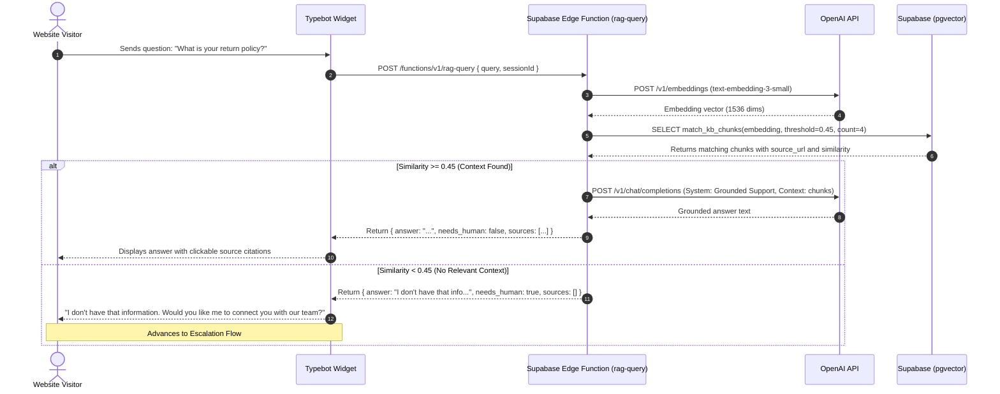
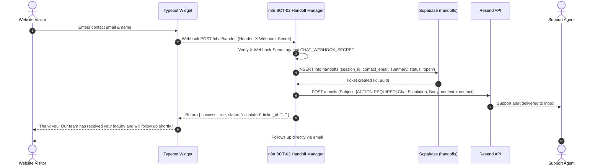

# Automation Architecture — Website AI Chatbot System

**Document Version:** 2.1
**Author:** Robin Sehnalík

---

## Executive Summary

The **Website AI Chatbot System** provides low-latency, grounded customer assistance and seamless asynchronous human support escalation for company websites and e-commerce stores.

### 1. Architectural Decisions & Scope

Based on production evaluation and architecture review, this system standardizes on a **single approved architecture**:

- **Conversational Frontend**: Self-hosted or cloud-managed **Typebot** acting as the embeddable web chat widget and visual conversation manager.
- **Low-Latency RAG Engine**: A dedicated **Supabase Edge Function (`rag-query`)** that computes query embeddings, executes calibrated vector similarity search against Supabase pgvector, and generates grounded completions via OpenAI (`gpt-4o-mini`).
- **Asynchronous Automation Layer (n8n)**: Dedicated exclusively to asynchronous workflows:
  - [`bot-02-handoff-manager.json`](./n8n-workflows/bot-02-handoff-manager.json): Ingests authenticated escalation webhooks, creates support tickets, and delivers email/Slack alerts to human staff.
  - [`bot-03-knowledge-sync.json`](./n8n-workflows/bot-03-knowledge-sync.json): Scheduled and webhook-driven knowledge ingestion and vector synchronization.
  - [`bot-err-error-handler.json`](./n8n-workflows/bot-err-error-handler.json): Global exception monitoring.

### 2. Problems Resolved from Prior Iterations

1. **Zero Visitor Loop Congestion in n8n**: The visitor query path is handled entirely by the Supabase Edge Function (~1.2s turn latency). n8n is never in the real-time token streaming loop.
2. **No Frontend Code Debt**: Replaced custom vanilla JavaScript widgets with battle-tested Typebot web components.
3. **Calibrated Semantic Retrieval**: Lowered the cosine similarity threshold from an unrealistic `0.70` down to a calibrated **`0.45`** for `text-embedding-3-small`. Replaced `ivfflat` with an **HNSW index** to prevent recall drop on small or growing datasets.
4. **Security & RLS**: All webhooks enforce `X-Webhook-Secret` verification. Row Level Security (RLS) restricts access to internal tables. Bot disclosure is enforced on the opening message.

---

## 1. Architectural Principles

1. **Grounded In-Context Knowledge**: Answers are generated strictly from indexed company knowledge (FAQ, shipping, returns, product documentation). If similarity falls below the calibrated `0.45` threshold, the assistant acknowledges lack of context and offers human escalation.
2. **n8n Off the Real-Time Path**: Visitor chat turns bypass n8n completely. n8n executes strictly as an asynchronous webhook consumer for human handoffs and scheduled background indexing.
3. **Calibrated Thresholds & HNSW Indexing**: Uses HNSW indexing (`vector_cosine_ops`) for deterministic recall without empty-list recall degradation.
4. **Guaranteed Human Intervention**: Escalation collects visitor email, name, and inquiry context, dispatches a secure webhook to n8n, and immediately notifies on-call staff via Resend/Slack.
5. **Defense-in-Depth & Privacy**: Webhooks authenticate via shared secrets; Supabase tables are protected by Row Level Security; visitor PII is purged after a 90-day retention window.
6. **Transparent Bot Disclosure**: In compliance with transparency standards, the bot explicitly identifies itself as an automated AI assistant in its greeting message.

---

## 2. High-Level System Architecture

```mermaid
flowchart TD
    subgraph Visitors["Website Visitors"]
        WebPage["Website / E-Commerce Store"]
        Widget["Typebot Embeddable Web Component"]
    end

    subgraph EdgeLayer["Low-Latency Serverless Layer"]
        EdgeFn["Supabase Edge Function: rag-query\n(Deno / TypeScript Runtime)"]
    end

    subgraph DataLayer["Supabase (PostgreSQL + pgvector)"]
        KBDocs[("kb_documents (Source Metadata)")]
        KBChunks[("kb_chunks (HNSW Vector Index)")]
        Handoffs[("handoffs (Escalation Tickets)")]
        UnansweredView["v_unanswered_queries (SQL View)"]
    end

    subgraph LLM["OpenAI API"]
        EmbedAPI["Embeddings API (text-embedding-3-small)"]
        ChatAPI["Chat Completions (gpt-4o-mini)"]
    end

    subgraph N8N["n8n Asynchronous Automation Runtime"]
        BOT2["BOT-02 Handoff & Escalation Manager\n(Authenticated Webhook POST /chat/handoff)"]
        BOT3["BOT-03 Knowledge Ingestion & Sync\n(Content Hash Deduplication)"]
        BOTERR["BOT-ERR Global Error Handler"]
    end

    subgraph External["Alerting & Notification"]
        Resend["Resend API (Email Alerts to Support Team)"]
        Staff["Human Support Team"]
    end

    %% Real-time Visitor Loop (Sub-2s)
    WebPage -->|Embedded Chat| Widget
    Widget -->|POST /functions/v1/rag-query| EdgeFn
    EdgeFn -->|1. Generate Embedding| EmbedAPI
    EmbedAPI -->>|Vector| EdgeFn
    EdgeFn -->|2. match_kb_chunks >= 0.45| KBChunks
    KBChunks -->>|Matched Chunks + source_url| EdgeFn
    EdgeFn -->|3. Grounded Completion| ChatAPI
    ChatAPI -->>|Streamed / Structured Reply| EdgeFn
    EdgeFn -->>|Return answer & sources| Widget

    %% Asynchronous Escalation Loop
    Widget -->|On Escalation: POST /chat/handoff with X-Webhook-Secret| BOT2
    BOT2 -->|1. Store Open Ticket| Handoffs
    BOT2 -->|2. Dispatch Email Alert| Resend
    Resend --> Staff
    Handoffs -.-> UnansweredView

    %% Background Knowledge Sync
    KBDocs -->|Scheduled Re-index| BOT3
    BOT3 -->|Hash & Embed| EmbedAPI
    BOT3 -->|Idempotent Upsert| KBChunks
    BOT2 -.->|On Failure| BOTERR
    BOT3 -.->|On Failure| BOTERR
```

---

## 3. Core Data Flows & Sequence Diagrams

### 3.1. Standard Visitor RAG Query (Real-Time Sub-2s Path)



### 3.2. Asynchronous Human Escalation Flow



---

## 4. Workflow & Component Specifications

### 4.1. Supabase Edge Function (`supabase/functions/rag-query/index.ts`)

- **Role**: Single serverless endpoint for Typebot.
- **Authentication**: Authenticated via Supabase Anon Key with IP rate-limiting.
- **Calibrated Search**: Calls `match_kb_chunks` with `match_threshold = 0.45`.
- **Latency**: Typical round-trip execution is 800ms–1400ms.

### 4.2. Asynchronous n8n Workflows (`n8n-workflows/`)

| File                                                                         | Name                              | Trigger                        | Primary Purpose                                                                                                    |
| :--------------------------------------------------------------------------- | :-------------------------------- | :----------------------------- | :----------------------------------------------------------------------------------------------------------------- |
| [`bot-02-handoff-manager.json`](./n8n-workflows/bot-02-handoff-manager.json) | BOT-02 Handoff Manager            | Webhook (`POST /chat/handoff`) | Authenticates webhook via `X-Webhook-Secret`, records ticket in `handoffs`, and dispatches alert email via Resend. |
| [`bot-03-knowledge-sync.json`](./n8n-workflows/bot-03-knowledge-sync.json)   | BOT-03 Knowledge Ingestion & Sync | Cron (`0 3 * * *` Daily)       | Chunks documents with `content_hash` deduplication, generates embeddings, and upserts into `kb_chunks`.            |
| [`bot-err-error-handler.json`](./n8n-workflows/bot-err-error-handler.json)   | BOT-ERR Global Error Handler      | Error Trigger                  | Traps uncaught exceptions across background workflows and alerts admin.                                            |

---

## 5. Database Schema & Security (Supabase)

```sql
-- 1. Enable pgvector
CREATE EXTENSION IF NOT EXISTS vector;

-- 2. Knowledge Documents Catalog
CREATE TABLE IF NOT EXISTS kb_documents (
  id UUID PRIMARY KEY DEFAULT gen_random_uuid(),
  title TEXT NOT NULL,
  source_type TEXT NOT NULL CHECK (source_type IN ('faq', 'policy', 'article', 'catalog')),
  source_url TEXT,
  updated_at TIMESTAMPTZ DEFAULT now()
);

-- 3. Knowledge Chunks with Content Hash Deduplication
CREATE TABLE IF NOT EXISTS kb_chunks (
  id UUID PRIMARY KEY DEFAULT gen_random_uuid(),
  document_id UUID REFERENCES kb_documents(id) ON DELETE CASCADE,
  content TEXT NOT NULL,
  content_hash TEXT UNIQUE NOT NULL, -- Deduplication key
  source_url TEXT,
  embedding VECTOR(1536), -- text-embedding-3-small
  created_at TIMESTAMPTZ DEFAULT now()
);

-- HNSW Index for rapid, accurate vector similarity search
CREATE INDEX IF NOT EXISTS idx_kb_chunks_hnsw
ON kb_chunks USING hnsw (embedding vector_cosine_ops);

-- 4. Vector Match Function (Calibrated Threshold: 0.45)
CREATE OR REPLACE FUNCTION match_kb_chunks(
  query_embedding VECTOR(1536),
  match_threshold FLOAT DEFAULT 0.45,
  match_count INT DEFAULT 4
)
RETURNS TABLE (
  id UUID,
  document_id UUID,
  content TEXT,
  similarity FLOAT,
  source_url TEXT,
  document_title TEXT
)
LANGUAGE plpgsql SECURITY DEFINER AS $$
BEGIN
  RETURN QUERY
  SELECT
    c.id,
    c.document_id,
    c.content,
    1 - (c.embedding <=> query_embedding) AS similarity,
    c.source_url,
    d.title AS document_title
  FROM kb_chunks c
  LEFT JOIN kb_documents d ON c.document_id = d.id
  WHERE 1 - (c.embedding <=> query_embedding) >= match_threshold
  ORDER BY c.embedding <=> query_embedding
  LIMIT match_count;
END;
$$;

-- 5. Support Handoff Escalation Tickets
CREATE TABLE IF NOT EXISTS handoffs (
  id UUID PRIMARY KEY DEFAULT gen_random_uuid(),
  session_id TEXT NOT NULL,
  contact_email TEXT NOT NULL,
  contact_name TEXT,
  summary TEXT NOT NULL,
  status TEXT DEFAULT 'open' CHECK (status IN ('open', 'in_progress', 'resolved', 'closed')),
  created_at TIMESTAMPTZ DEFAULT now(),
  resolved_at TIMESTAMPTZ
);

CREATE INDEX IF NOT EXISTS idx_handoffs_status ON handoffs(status);
CREATE INDEX IF NOT EXISTS idx_handoffs_created_at ON handoffs(created_at DESC);

-- 6. Operational View: Unanswered Queries & Open Tickets
CREATE OR REPLACE VIEW v_unanswered_queries AS
SELECT
  id, session_id, contact_email, contact_name, summary, created_at
FROM handoffs
WHERE status = 'open'
ORDER BY created_at DESC;

-- 7. Row Level Security (RLS) Configuration
ALTER TABLE kb_documents ENABLE ROW LEVEL SECURITY;
ALTER TABLE kb_chunks ENABLE ROW LEVEL SECURITY;
ALTER TABLE handoffs ENABLE ROW LEVEL SECURITY;

CREATE POLICY "Public read knowledge chunks"
ON kb_chunks FOR SELECT TO anon, authenticated USING (true);

CREATE POLICY "Public insert handoffs"
ON handoffs FOR INSERT TO anon, authenticated WITH CHECK (true);

CREATE POLICY "Service role full access handoffs"
ON handoffs FOR ALL TO service_role USING (true);

-- 8. Data Retention & PII Cleanup Routine
CREATE OR REPLACE FUNCTION purge_expired_handoffs()
RETURNS void LANGUAGE plpgsql SECURITY DEFINER AS $$
BEGIN
  DELETE FROM handoffs WHERE created_at < now() - INTERVAL '90 days';
END;
$$;
```

---

## 6. Security, Compliance & Safety Guardrails

1. **Shared-Secret Webhook Authentication**:
   The `/chat/handoff` webhook endpoint strictly verifies the `X-Webhook-Secret` header before accepting payloads or sending emails.
2. **Row Level Security (RLS)**:
   Enabled across all tables. The public anonymous key can only execute the read-only `match_kb_chunks` search and insert handoff tickets.
3. **Calibrated Thresholds & Grounding**:
   Cosine threshold is calibrated to **`0.45`**, providing high recall while screening out irrelevancies.
4. **Bot Disclosure & Transparency**:
   In adherence to consumer protection and EU AI guidelines, the bot greeting explicitly states: _"Hello! I am an AI Support Assistant for [Company]..."_
5. **Data Retention & Privacy**:
   Tickets in `handoffs` expire and are deleted after 90 days via `purge_expired_handoffs()`. No conversational transcripts are persisted in Postgres.

---

## 7. Repository Layout & File Map

```text
website-chatbot/
├── architecture.md                     # Approved System Specification v2.1.0 (this document)
├── README.md                           # Deployment Guide & Quickstart
├── deployments/
│   └── typebot/
│       ├── README.md                   # Typebot setup & embedding instructions
│       ├── docker-compose.yml          # Production self-hosted Docker Compose
│       └── typebot-flow-export.json    # Complete importable Typebot V6 visual flow
├── supabase/
│   └── functions/
│       └── rag-query/
│           └── index.ts                # Serverless Deno RAG query Edge Function
├── n8n-workflows/
│   ├── bot-02-handoff-manager.json     # Asynchronous authenticated handoff & email alert
│   ├── bot-03-knowledge-sync.json      # Asynchronous deduplicated vector indexing
│   └── bot-err-error-handler.json      # Global error trap & administrator notifier
└── sql/
    └── schema.sql                      # Supabase PostgreSQL schema with HNSW index & RLS
```
