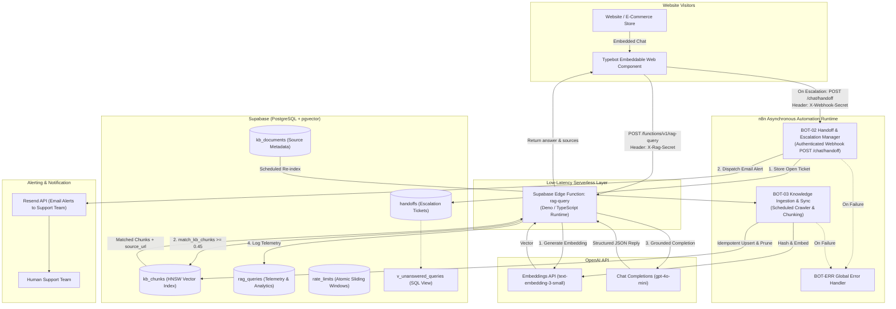
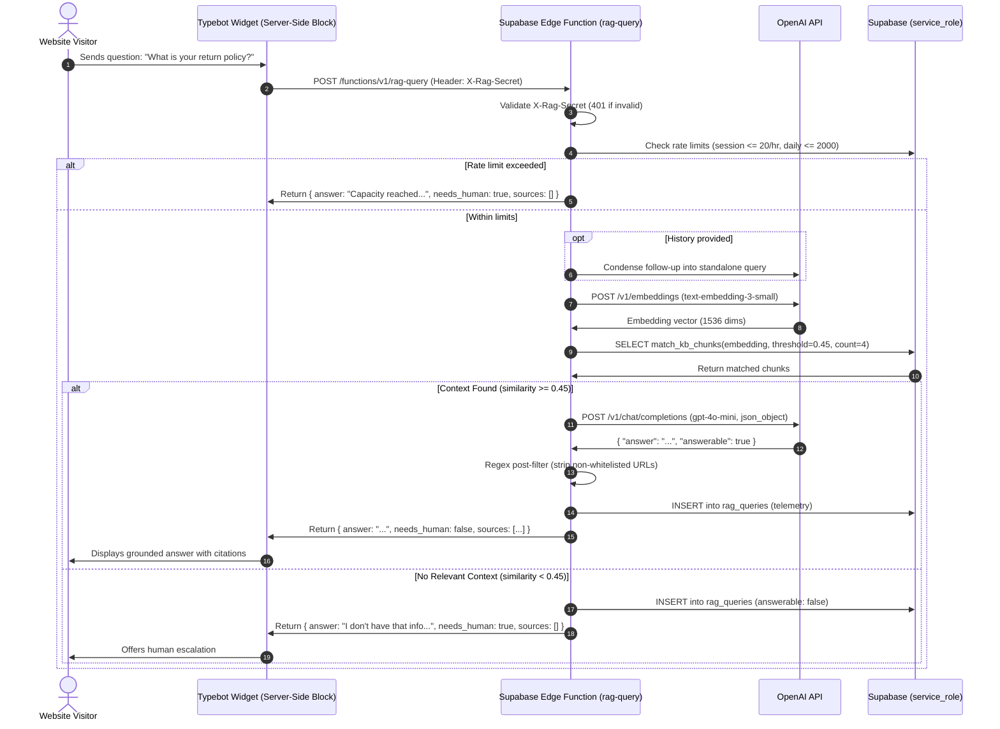
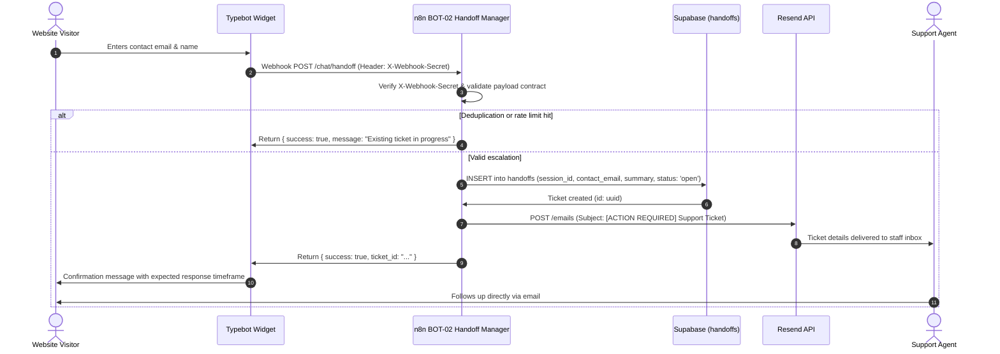

# Automation Architecture — Website AI Chatbot System

**Status:** Draft Architecture Specification  

---

## Executive Summary

The **Website AI Chatbot System** provides low-latency, grounded customer assistance and asynchronous human support escalation for company websites and e-commerce stores.

### 1. Scope and Limitations

* **Asynchronous Human Handoff Only**: No live agent chat. When the assistant cannot answer or the visitor requests a human, it captures contact details and dispatches an asynchronous escalation ticket.
* **No Order-Status Lookups**: Order tracking, transactional lookups, and account-specific queries are out of scope; such questions always route to human support.
* **No Token Streaming**: The conversational widget receives a complete structured JSON response (`{ answer, needs_human, sources }`) from the Edge Function rather than streaming partial tokens.
* **No Product Prices or Live Stock**: The knowledge base indexes static support documentation, FAQs, and policies (`faq`, `policy`, `article`). Real-time product inventory, catalog pricing, and stock levels are excluded.

### 2. Background & Decision Record

* **Background**: The initial architecture routed visitor messages through synchronous n8n workflows, resulting in high latency, worker queue congestion, and complex custom widget maintenance.
* **Architecture Decision**: The system was redesigned to decouple the real-time query path (handled by a lightweight Supabase Edge Function) from asynchronous support workflows (handled by n8n).
* **Changelog**:
  * Replaced custom frontend widget with Typebot.
  * Migrated visitor RAG query execution to Supabase Edge Function (`rag-query`).
  * Retired synchronous chat orchestrator workflows in n8n; retained n8n strictly for background handoffs and sync.
  * Replaced IVFFlat with an HNSW vector index (`vector_cosine_ops`).
  * Enforced strict service-role isolation with deny-by-default Row Level Security.

---

## 1. Architectural Principles

1. **Retrieval-Grounded Knowledge**: Answers are generated strictly from company documentation retrieved via vector similarity search. If retrieved context is insufficient or falls below the provisional threshold (`0.45`), the assistant states that it lacks information and offers human escalation.
2. **Prompt-Injection Defense**: User questions and conversation history are treated as untrusted data wrapped in isolation tags. The system prompt instructs the model to ignore user instructions, output structured JSON, and invent no external URLs. A post-processing regex strips any hyperlink not present in the retrieved chunk metadata.
3. **n8n Off the Real-Time Path**: Real-time visitor query processing runs exclusively in the serverless Edge Function. n8n operates solely as an asynchronous consumer for handoff webhooks and scheduled document indexing.
4. **HNSW Vector Retrieval**: Vector similarity search uses HNSW indexing (`vector_cosine_ops`) over `text-embedding-3-small` embeddings, avoiding recall degradation as the knowledge base grows.
5. **Reliable Human Escalation**: When human support is required, the assistant collects the visitor's verified email, name, and inquiry details, dispatches an authenticated webhook to n8n, and alerts on-call staff via email.
6. **Deny-by-Default Access & Privacy**: Database access from `anon` and `authenticated` roles is entirely revoked. Only the backend `service_role` can access tables, views, and functions. Retention routines purge handoffs after 90 days, query logs after 30 days, and rate-limit buckets after 2 days.
7. **Transparent Bot Disclosure**: The opening greeting explicitly discloses that the assistant is an automated AI and provides a direct link to the company privacy notice.

---

## 2. High-Level System Architecture



---

## 3. Core Data Flows & Sequence Diagrams

### 3.1. Standard Visitor RAG Query



### 3.2. Asynchronous Human Escalation Flow



---

## 4. Data-Flow & Privacy Table

| Data Store / Component | Data Stored | PII Present | Retention Period | Access Controls |
| :--- | :--- | :--- | :--- | :--- |
| **Supabase `kb_documents`** | Public documentation URLs, titles, content hashes | None | Indefinite (until deleted or updated) | `service_role` only; RLS enabled |
| **Supabase `kb_chunks`** | Public documentation text chunks, embeddings | None | Indefinite (synchronized with documents) | `service_role` only; RLS enabled |
| **Supabase `handoffs`** | Session ID, visitor name, visitor email, inquiry summary, status | Yes (Name, Email, Inquiry) | **90 days** (purged via `purge_expired_data()`) | `service_role` only; RLS enabled |
| **Supabase `rag_queries`** | Session hash (SHA-256), query text, top similarity, flags | None (Session ID is hashed; query text may contain user inputs) | **30 days** (purged via `purge_expired_data()`) | `service_role` only; RLS enabled |
| **Supabase `rate_limits`** | Sliding window rate keys and counts | None | **2 days** (purged via `purge_expired_data()`) | `service_role` only; RLS enabled |
| **Typebot Internal Postgres** | Session states, user inputs, conversation flow variables | Yes (visitor email and name during escalation) | Configurable (recommended: 30 days or disabled) | Internal network only; encrypted at rest |
| **OpenAI API** | Query prompts, embeddings input | Transient in request (Zero Data Retention agreement recommended) | Transient (per OpenAI enterprise policy) | Encrypted TLS in transit |
| **Resend API** | Escalation alert emails (recipient staff email, visitor email/name) | Yes (Name, Email, Inquiry) | Per Resend log retention (typically 30 days) | API key authentication |

---

## 5. Workflow Catalog (n8n)

| File | Name | Trigger | Primary Purpose | Writes |
| :--- | :--- | :--- | :--- | :--- |
| [`bot-02-handoff-manager.json`](./n8n-workflows/bot-02-handoff-manager.json) | BOT-02 Handoff & Escalation Manager | Webhook (`POST /chat/handoff`) | Authenticates webhook via `X-Webhook-Secret`, validates payload, logs ticket in `handoffs`, and dispatches alert email via Resend. | `handoffs` table |
| [`bot-03-knowledge-sync.json`](./n8n-workflows/bot-03-knowledge-sync.json) | BOT-03 Knowledge Ingestion & Sync | Schedule (`0 3 * * *` Daily) or Manual | Iterates `kb_documents`, chunks text, generates embeddings, and upserts into `kb_chunks` with `content_hash` deduplication. | `kb_chunks` table |
| [`bot-err-error-handler.json`](./n8n-workflows/bot-err-error-handler.json) | BOT-ERR Global Error Handler | Error Trigger | Catches uncaught runtime exceptions across background workflows and emails engineering staff. | Admin notification email |

---

## 6. Open Decisions / To Verify

The following items are deferred for validation during deployment:

1. **Cloudflare Turnstile Widget Integration**: Evaluate embedding Cloudflare Turnstile inside or adjacent to the Typebot embed snippet to block bot traffic before it reaches the Edge Function.
2. **`pg_cron` Extension Availability**: Confirm whether the target Supabase project tier includes and enables `pg_cron` for running `purge_expired_data()`, or if retention should be scheduled via an external cron / n8n workflow.
3. **Secondary Alert Channel**: Verify whether support operations require an independent secondary notification channel (e.g., Slack webhook or SMS) in the event of Resend API downtime.
4. **Typebot Cloud vs. Self-Hosted**: Assess operational trade-offs between self-hosting Typebot (via the provided `docker-compose.yml`) versus using managed Typebot Cloud.
5. **Typebot Result Storage Configuration**: Determine whether to enable Typebot's native database result logging for analytics or configure sessions as transient to minimize data storage.
6. **Non-URL Knowledge Ingestion**: Define ingestion workflows for knowledge sources that do not have public URLs (e.g., internal Markdown files, Notion databases, or PDF policies).
7. **Supported Languages & Translation**: Determine whether multi-lingual customer support should be handled dynamically by the LLM system prompt or through localized knowledge bases.

---

## 7. Repository Layout & File Map

```text
website-chatbot/
├── architecture.md                     # Draft System Architecture Specification (this document)
├── README.md                           # Deployment Guide, Test Plan, and Setup Walkthrough
├── .env.example                        # Template for all environment variables and secrets
├── deployments/
│   └── typebot/
│       ├── README.md                   # Typebot setup & embedding instructions
│       ├── docker-compose.yml          # Production self-hosted Docker Compose stack
│       └── typebot-flow.spec.md        # Block-by-block visual flow assembly specification
├── eval/
│   ├── README.md                       # Empirical RAG evaluation methodology and metric formulas
│   └── questions.example.csv           # Benchmark dataset of 30+ domain and out-of-scope questions
├── n8n-workflows/
│   ├── bot-02-handoff-manager.json     # Asynchronous authenticated handoff & email alert
│   ├── bot-03-knowledge-sync.json      # Asynchronous deduplicated vector indexing
│   ├── bot-err-error-handler.json      # Global error trap & administrator notifier
│   └── CHANGES-REQUIRED.md             # Node-level design for deduplication and full crawler pruning
├── sql/
│   └── schema.sql                      # Hardened Supabase PostgreSQL schema with RLS & service-role isolation
└── supabase/
    └── functions/
        └── rag-query/
            └── index.ts                # Serverless Deno RAG query Edge Function
```
